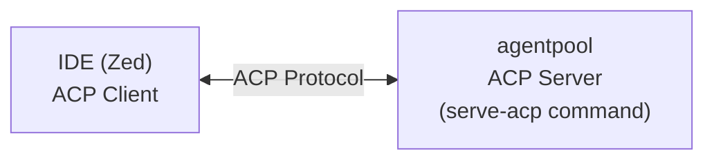
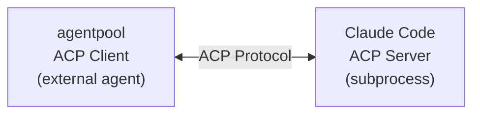
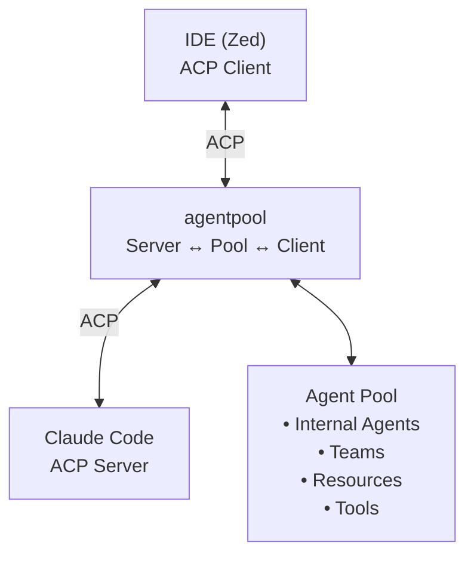

## What is ACP?

The Agent Client Protocol (ACP) is a standardized JSON-RPC 2.0 protocol that enables communication between code editors and AI agents. It allows AgentPool to integrate seamlessly with desktop applications and IDEs that support the protocol.

ACP provides:

- Bidirectional communication between editor and agent
- Session management and conversation history
- File system operations with permission handling
- Terminal integration for command execution
- Tool confirmation mode switching for different workflows

## ACP Agents as First-Class Citizens

In AgentPool, external ACP agents are **first-class citizens** in the agent ecosystem. They:

- ✅ **Participate fully in the agent pool** - Can be discovered, delegated to, and coordinated with
- ✅ **Support most features of "native" Pydantic-AI based agents** - Tools, contexts, delegation, state management
- ✅ **Run in configurable environments** - Local, Docker, E2B, remote sandboxes
- ✅ **Access internal toolsets** - Via automatic MCP bridge for supported agents
- ✅ **Auto-managed lifecycle** - Automatic spawn, cleanup, and error handling

The key difference is that ACP agents run as **separate processes** communicating via the ACP protocol, while still appearing as integrated members of the pool to other agents.

## Installation & Setup

Using uvx for one-off usage:

```bash
uvx --python 3.13 agentpool@latest serve-acp --help
```

## CLI Usage

### Basic Commands

Start an ACP server from a configuration file:

```bash
agentpool serve-acp agents.yml
```

### Available Options

See [`serve-acp`](../cli/serve-acp.md) for all options (transport, agent selection, client
skills, protocol version, debugging). The server speaks ACP v1 and v2.

## IDE Configuration

### Zed Editor

Add this configuration to your Zed `settings.json`:

```json
{
  "agent_servers": {
    "AgentPool": {
      "command": "uvx",
      "args": [
        "--python",
        "3.13",
        "agentpool[coding]@latest",
        "serve-acp",
        "https://raw.githubusercontent.com/phil65/agentpool/refs/heads/main/docs/examples/create_docs/config.yml"
      ],
      "env": {
        "OPENAI_API_KEY": "your-api-key-here"
      }
    }
  }
}
```

This configuration:

- Uses uvx to run the latest version without local installation
- Points to a remote configuration file with multiple expert agents
- Specifies OpenAI as the model provider
- Sets the required API key via environment variables

### Other IDEs

For IDEs that support ACP, the general pattern is:

1. Set the command to `agentpool` (or `uvx agentpool@latest`)
2. Add `serve-acp` as the first argument
3. Specify your configuration file path
4. Add any desired CLI options
5. Set required environment variables (API keys, etc.)

## The ACP Bridge Concept

### AgentPool as Both Server AND Client

Understanding AgentPool's ACP integration requires grasping a key architectural concept: **AgentPool acts as BOTH an ACP server AND an ACP client simultaneously**. This dual role is what makes the integration so powerful.

#### As an ACP Server (IDE Integration)

When you run `agentpool serve-acp`, it becomes an **ACP server** that IDEs can connect to:



In this mode, AgentPool:

- Receives prompts from the IDE
- Sends back agent responses
- Handles file operations on behalf of the IDE
- Manages terminal sessions
- Provides tool confirmation modes for the IDE to switch between

#### As an ACP Client (External Agent Integration)

At the same time, AgentPool can act as an **ACP client** to integrate external ACP agents:



In this mode, AgentPool:

- Spawns external ACP agent processes (Claude Code, Gemini CLI, etc.)
- Sends prompts to those agents
- Receives their responses
- Manages their lifecycle (startup, cleanup)
- Provides them access to internal toolsets via MCP

#### The Bridge: Both Roles Together

The real power comes when **both roles work together**:



#### Real-World Example

When you configure Zed to use AgentPool with external ACP agents:

1. **Zed** connects to AgentPool via ACP (IDE → Server)
2. **AgentPool** maintains an agent pool with both:
   - Internal agents (regular Python-based agents)
   - External agents (spawned ACP processes like Claude Code)
3. When you send a prompt through Zed:
   - It goes to AgentPool (Server role)
   - AgentPool routes it to the appropriate agent
   - If the agent is internal → direct execution
   - If the agent is external → ACP client call to that subprocess
4. **Orchestration** becomes possible:
   - An internal agent can delegate to Claude Code
   - Claude Code can call back to internal agents via MCP toolsets
   - All coordinated through the agent pool

#### Why This Matters

This bridge architecture enables:

- ✅ **Unified interface**: IDE sees one server, regardless of how many agents
- ✅ **Heterogeneous agents**: Mix internal Python agents with external protocol-bridged agents
- ✅ **Transparent delegation**: Agents can work together across process boundaries
- ✅ **Toolset sharing**: External agents access internal capabilities via MCP bridge
- ✅ **Environment flexibility**: External agents can run in Docker, E2B, remote servers
- ✅ **Protocol translation**: IDE ↔ ACP ↔ Internal Pool ↔ ACP ↔ External Agents

The key insight: **AgentPool doesn't just implement ACP—it bridges multiple ACP worlds together into a unified orchestration layer**.

## Modes and Config Options

Each agent's modes and config options (permission / tool confirmation mode, model, reasoning
effort, ...) are offered to the client as ACP session modes and config options, so the IDE's
selectors switch them for the running session.

## External ACP Agents

AgentPool integrates external ACP agents (Claude Code, Codex, Goose, Gemini CLI, ...) into the
pool. They are started from the [ACP registry](https://agentclientprotocol.com/registry), from
a command, or reached over the network:

```yaml
agents:
  claude:
    type: acp
    provider: registry
    registry_id: claude-acp
    display_name: "Claude Code"

  goose:
    type: acp
    provider: registry
    registry_id: goose

  gemini:
    type: acp
    provider: registry
    registry_id: gemini
    extra_args: ["--model", "gemini-2.5-pro"]

  custom:
    type: acp
    provider: custom
    command: my-acp-server
    args: ["--stdio"]

  remote:
    type: acp
    provider: remote
    url: https://example.com/api/acp

  coordinator:
    type: native
    model: openai:gpt-5-mini
    tools:
      - type: subagent  # delegate to the ACP agents
```

All options: [ACP Agents](../configuration/node-types/acp-agents.md). For Claude Code and Codex,
the dedicated `claude_code` and `codex` agent types talk to their SDKs directly and support
more (steering, compaction, native sessions).

## ACP Agent Architecture

### How ACP Agents Operate

1. **Process spawning**: the agent process starts (registry entries are installed via
   uvx / npx / binaries), or a connection to a remote agent is opened.
2. **Initialization**: capabilities are exchanged (`initialize`, authentication if needed).
3. **Sessions**: every AgentPool session gets its own ACP session (`session/new`, or
   `session/load` / `session/resume` for stored ones), with the MCP servers and working
   directory of the session.
4. **Prompts**: `session/prompt`, streamed back as session updates that AgentPool translates
   into its own events.
5. **Lifecycle**: interrupts use `session/cancel`; processes are stopped with the pool.

### Execution Environments

ACP agents use two environments:

| Field | Purpose |
|---|---|
| `environment` | Where AgentPool's tools for this agent run (string = working directory) |
| `client_execution_environment` | Where the agent's own file and terminal requests are served (falls back to `environment`) |

```yaml
agents:
  remote_coder:
    type: acp
    provider: registry
    registry_id: claude-acp
    environment: /path/to/project
    client_execution_environment:
      type: docker
      image: python:3.13-slim
```

So the agent process can run locally while its file and terminal requests operate in a
Docker container, over SSH or in a cloud sandbox. See
[Execution Environments](../configuration/execution-environments.md) for all environment
types.

!!! note "Environment override when serving over ACP"
    When the pool itself is served over ACP (IDE integration), the session's environment is the
    client's (an ACP execution environment routing file and terminal operations to the IDE).
    `client_execution_environment` is not overridden.

### Permission Model

```yaml
agents:
  restricted:
    type: acp
    provider: registry
    registry_id: claude-acp
    allow_file_operations: false  # Disable file read/write requests
    allow_terminal: false         # Disable terminal requests
    auto_approve: false           # Ask the user for permission requests
```

Permission requests of the external agent are forwarded to the user through AgentPool's input
provider (and from there to the connected client, if any).

## Toolset Bridging via MCP

ACP agents that support MCP get AgentPool's tools through an in-process MCP server: the tools
listed in `tools` are served on localhost, and the server's URL is passed to the agent's
session. Tool calls run inside the pool with a proper `AgentContext`, so delegation tools reach
the pool's other agents.

```yaml
agents:
  claude_orchestrator:
    type: acp
    provider: registry
    registry_id: claude-acp
    tools:
      - type: subagent             # task, list_available_nodes
      - type: search
        web_search: tavily
      - type: import
        import_path: webbrowser.open
    mcp_servers:                   # further MCP servers, passed through
      - "npx -y @modelcontextprotocol/server-filesystem /project"
      - type: sse
        url: https://api.example.com/mcp

  specialist:
    type: native
    model: openai:gpt-5-mini
    system_prompt: "Expert in data processing"
```

```python
from agentpool import AgentPool


async def main():
    async with AgentPool("config.yml") as pool:
        claude = pool.get_agent("claude_orchestrator")
        result = await claude.run(
            "List the available agents, then delegate the data processing to specialist"
        )
```

Only tools listed in `tools` are exposed, and they see only what their `AgentContext`
provides. Tools that require confirmation still ask through the input provider.
