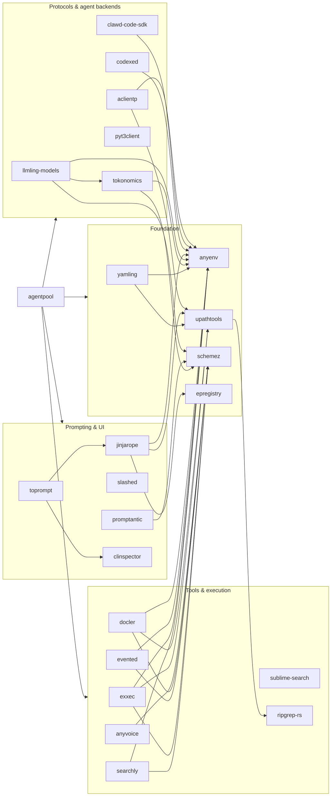
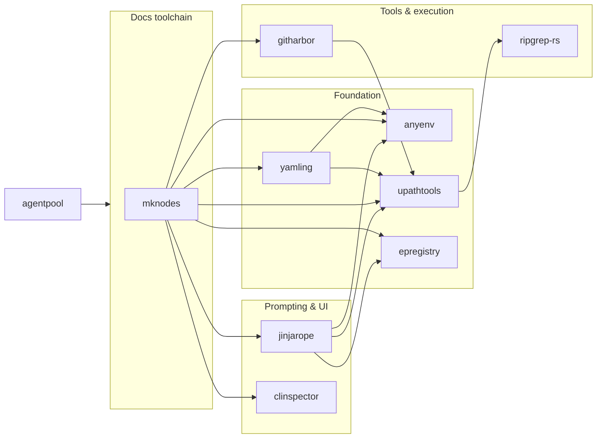

# Ecosystem

AgentPool is built from a set of smaller packages maintained alongside it
([github.com/phil65](https://github.com/phil65)). This page shows how they depend on each other.
Generated from `uv.lock` by `scripts/gen_ecosystem.py`; regenerate it after dependency changes.

## Runtime (incl. extras)

`agentpool` uses packages of every group (see "Used by" in the table, incl. the extras they come
with); the arrows between packages show how they depend on each other.

| Package | Role | Description | Used by |
|---|---|---|---|
| [aclientp](https://github.com/phil65/aclientp) | Protocols & agent backends | Agent Client Protocol (ACP) for Python: typed v1 and draft v2, checked against the upstream schema | agentpool |
| [clawd-code-sdk](https://github.com/phil65/claude-agent-sdk-python) | Protocols & agent backends | Python SDK for Claude Code | agentpool |
| [codexed](https://github.com/phil65/codexed) | Protocols & agent backends | Async, typed Python client for the OpenAI Codex app-server JSON-RPC protocol | agentpool |
| [pyt3client](https://github.com/phil65/pyt3client) | Protocols & agent backends | Thin, typed Python client for T3 Code environments (via their MCP endpoint) | agentpool |
| [llmling-models](https://github.com/phil65/llmling-models) | Protocols & agent backends | Extra pydantic-ai models, providers and toolsets (human-in-the-loop, model routing, Claude Code, code mode) for AgentPool | agentpool |
| [tokonomics](https://github.com/phil65/tokonomics) | Protocols & agent backends | Calculate LLM usage costs from token counts and discover models and pricing across providers | agentpool, llmling-models |
| [exxec](https://github.com/phil65/exxec) | Tools & execution | Unified async API to run code and commands locally, in Docker, over SSH, or in cloud sandboxes | agentpool |
| [docler](https://github.com/phil65/docler) | Tools & execution | Abstractions & Tools for OCR / document processing | agentpool |
| [searchly](https://github.com/phil65/searchly) | Tools & execution | Search tools for agents | agentpool |
| [sublime-search](https://github.com/phil65/sublime-search) | Tools & execution |  | agentpool |
| [ripgrep-rs](https://github.com/phil65/python-ripgrep) | Tools & execution | A Python wrapper for ripgrep | agentpool, upathtools |
| [evented](https://github.com/phil65/evented) | Tools & execution | Event emitters. | agentpool |
| [anyvoice](https://github.com/phil65/anyvoice) | Tools & execution | Common interface for streaming tts providers | agentpool (`tts` extra) |
| [promptantic](https://github.com/phil65/promptantic) | Prompting & UI | Terminal forms for JSON Schemas and Python types (Textual or prompt-toolkit) | agentpool |
| [slashed](https://github.com/phil65/slashed) | Prompting & UI | Slash commands and autocompletions | agentpool |
| [toprompt](https://github.com/phil65/toprompt) | Prompting & UI | Convert python objects to LLM-friendly descriptions | agentpool |
| [jinjarope](https://github.com/phil65/jinjarope) | Prompting & UI | Jinja2 toolkit: enhanced Environment, extra filters / tests, fsspec-based loaders and TOML JinjaFiles. | agentpool, toprompt |
| [clinspector](https://github.com/phil65/clinspector) | Prompting & UI | Introspect Python CLI apps (Typer, Click, Cleo, Cappa, Cyclopts, argparse) into structured data. | toprompt |
| [anyenv](https://github.com/phil65/anyenv) | Foundation | Compatibility layer for some basic operations to allow painless operation in PyOdide and Python pre-releases | aclientp, agentpool, clawd-code-sdk, codexed, docler, evented, exxec, jinjarope, llmling-models, searchly, tokonomics, yamling |
| [upathtools](https://github.com/phil65/upathtools) | Foundation | Async helpers, typed base classes and many filesystem implementations for fsspec and universal-pathlib | aclientp, agentpool, docler, exxec, jinjarope, yamling |
| [schemez](https://github.com/phil65/schemez) | Foundation | Pydantic toolkit for function schemas, JSON Schema to model conversion, tool code generation and config models | agentpool, anyvoice, docler, evented, exxec, llmling-models, promptantic, searchly, tokonomics |
| [epregistry](https://github.com/phil65/epregistry) | Foundation | A registry for entry points (cached and generically typed) | agentpool, jinjarope |
| [yamling](https://github.com/phil65/yamling) | Foundation | Enhanced YAML loading and dumping. | agentpool |

## Docs toolchain

The documentation (`docs` dependency group) is built with [Zensical](https://zensical.org);
[mknodes](https://github.com/phil65/mknodes) provides the `/// mknodes` blocks and generated pages.

| Package | Role | Description | Used by |
|---|---|---|---|
| [ripgrep-rs](https://github.com/phil65/python-ripgrep) | Tools & execution | A Python wrapper for ripgrep | upathtools |
| [githarbor](https://github.com/phil65/githarbor) | Tools & execution | Unified client for GitHub, GitLab and BitBucket | mknodes |
| [jinjarope](https://github.com/phil65/jinjarope) | Prompting & UI | Jinja2 toolkit: enhanced Environment, extra filters / tests, fsspec-based loaders and TOML JinjaFiles. | mknodes |
| [clinspector](https://github.com/phil65/clinspector) | Prompting & UI | Introspect Python CLI apps (Typer, Click, Cleo, Cappa, Cyclopts, argparse) into structured data. | mknodes |
| [anyenv](https://github.com/phil65/anyenv) | Foundation | Compatibility layer for some basic operations to allow painless operation in PyOdide and Python pre-releases | jinjarope, mknodes, yamling |
| [upathtools](https://github.com/phil65/upathtools) | Foundation | Async helpers, typed base classes and many filesystem implementations for fsspec and universal-pathlib | githarbor, jinjarope, mknodes, yamling |
| [epregistry](https://github.com/phil65/epregistry) | Foundation | A registry for entry points (cached and generically typed) | jinjarope, mknodes |
| [yamling](https://github.com/phil65/yamling) | Foundation | Enhanced YAML loading and dumping. | mknodes |
| [mknodes](https://github.com/phil65/mknodes) | Docs toolchain | Build Markdown documentation in Python from composable, project-aware nodes. | agentpool |
