**Connect all the agents!**



## Key Features

### 🔌 ACP Integration

First-class support for the Agent Client Protocol (ACP):

- Integrate directly into IDEs like Zed, VS Code, and others
- Wrap external agents (Claude Code, Goose, Codex, fast-agent) as nodes
- Unified node abstraction - ACP agents work like native agents
- Compose ACP agents into teams with native agents

### 📝 Easy Agent Configuration

AgentPool excels at static YAML-based agent configuration:

- Define agents with extreme detail in pure YAML (Pydantic-backed)
- Expansive JSON schema for IDE autocompletion and validation, backed by an extremely detailed schema.
- Multi-Agent setups with native as well as remote (ACP / AGUI) agents


### 🧩 Unified Node Architecture

Everything is a MessageNode - enabling seamless composition:

- **Native** agents with a large set of default tools
- **ACP** agents
- **AG-UI** agents
- Teams (parallel and sequential)
- Human-in-the-loop-agents
- All nodes share the same interface


## Dependencies

/// mknodes
{{ "agentpool"| MkDependencyTable }}
///

## License

MIT License - see [LICENSE](https://github.com/phil65/agentpool/blob/main/LICENSE) for details.

## Quick Start

### Basic Agent Configuration

```yaml
# agents.yml
agents:
  assistant:
    display_name: "Technical Assistant"
    model: openai:gpt-4
    system_prompt: You are a helpful technical assistant.
    tools:
      - type: file_access
```

### Python Usage

```python
from agentpool import AgentPool

async def main():
    async with AgentPool("agents.yml") as pool:
        agent = pool.get_agent("assistant")
        response = await agent.run("What is Python?")
        print(response.data)

if __name__ == "__main__":
    import anyio
    anyio.run(main)
```
